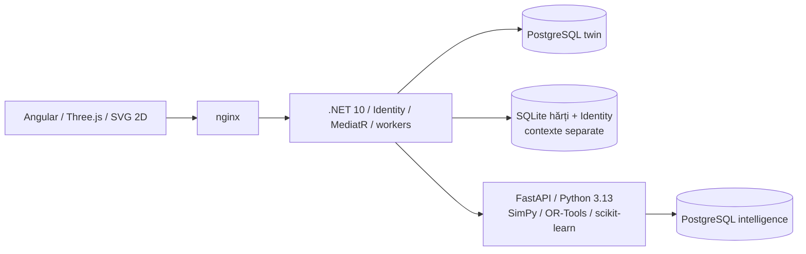

# AeroSynapse AI

Prototip Digital Twin pentru explorarea unor operațiuni aeroportuare: scenarii editabile, simulări reproductibile, optimizare de resurse și comparații bazate pe KPI calculați. **Datele demo sunt sintetice. Produsul nu este un sistem certificat de decizie aeroportuară și nu este validat pentru utilizare operațională reală.** Nu controlează echipamente fizice.

Fluxul principal „Operation Bottleneck” include 5 zboruri fictive, 3 checkpoint-uri, 600 pasageri, un incident surge editabil, baseline → CP-SAT → evaluare SimPy → comparație 2D/3D și raport. Dacă internetul sau LLM-ul lipsește, funcțiile core pot rula local dintr-un release pregătit anterior.

## Pornire rapidă

Cerințe: Git, Node.js 24, Docker Desktop pornit cu motor Linux și Docker Compose v2. Primul build necesită acces la registre și poate dura câteva minute. Din rădăcina repository-ului:

```sh
node scripts/start-bottleneck.mjs
```

Comanda inițializează numai credentialele lipsă în `.env` ignorat de Git, construiește serviciile și așteaptă healthcheck-urile. Nu resetează datele existente. Deschide [Flux de decizie](http://127.0.0.1:8080/operator-workflow), autentifică-te cu `operator.demo` și parola citită local din `.env`, apoi apasă **Încărcare scenariu demonstrativ**. Dacă ai configurat alt port, folosește URL-ul afișat de script. Parolele nu sunt incluse în frontend sau documentație; păstrează `.env` și state-ul privat în afara Git și a kit-ului public.

Alternativa Compose și comenzile de întreținere:

```sh
node scripts/init-demo.mjs
docker compose up --build --detach --wait --wait-timeout 180
docker compose ps
docker compose down
```

`down` păstrează volumele. Resetarea **explicită a datelor sintetice** folosește `docker compose --profile tools run --rm reset-data`; nu o folosi pentru recuperarea unui crash în timpul prezentării. Migrarea și seed-ul sunt automate în configurația Compose, fără SQL manual. Vezi [Docker și diagnosticare](docs/docker.md), [Identity / roluri / HTTPS](docs/security.md) și [demo-ul complet](docs/simulation-journey.md).

## Primii pași în interfață

Începe cu [fluxul de decizie](http://127.0.0.1:8080/operator-workflow) pentru a vedea cum se formează cozile și dacă mai mulți operatori le reduc. Apoi poți [crea un scenariu](http://127.0.0.1:8080/scenario-studio), îl poți simula în **Scenariile mele**, compara numărul de operatori și repeta testul pentru a observa variația. [Ghidul de simulare](docs/simulation-journey.md) explică fiecare pas.

## Arhitectură și date



Browserul folosește REST și SignalR prin API-ul .NET. Workerii execută cereri capturate în Python și persistă rezultatele verificate în PostgreSQL. Layout-ul versionat, configurația și seed-ul unui run rămân capturate chiar dacă scenariul se modifică. Replay-ul, harta și raportul citesc aceleași date persistate; animația nu recalculează KPI.

În demo, schemele `twin` și `intelligence` împart baza PostgreSQL; harta inițială și Identity au store-uri SQLite separate. Izolarea pe organizații folosește membership verificat și stocări/engine-uri distincte configurate server-side. FastAPI este un serviciu intern, iar credentialele pentru LLM sau provider rămân pe server. Vezi [securitate și acces](docs/security.md), [ERD și contracte](docs/product/data-and-contracts.md) și [indexul documentației](docs/README.md).

| Director | Conținut |
| --- | --- |
| `AeroSynapse.Client/` | Angular 21, Three.js, SVG 2D, replay din server, teste unitare și Chromium |
| `backend/src/` | Domain, Application, Infrastructure și API .NET 10 |
| `backend/tests/` | Teste domeniu/API, contracte, management și PostgreSQL |
| `intelligence/` | FastAPI, generator, SimPy, CP-SAT, forecast/ML și pytest; dependențe fixate |
| `contracts/` | Scheme JSON/OpenAPI versionate, exemple și corpusuri comune .NET–Python |
| `assets/` | Pipeline Blender, materiale, credite și proveniență |
| `scripts/`, `docs/` | Inițializare, CI/test/release, handoff și ghiduri de produs |

## Date sintetice, ipoteze și limite

Aurora/Bottleneck, zborurile, pasagerii, personalul, incidentele și capacitățile sunt fictive. Scara și geometria 3D nu sunt un plan autorizat al aeroportului Craiova. Distribuțiile de sosire/serviciu, costurile, limitele fizice declarate și coeficienții energiei sunt ipoteze de model. Minutele simulate diferă de timpul real al execuției.

KPI-urile au runId, unități, cohortă și timp; datele lipsă, numitorii invalizi și eșecurile nu sunt completate cu cifre inventate. Un seed comun permite o comparație controlată, fără a demonstra o îmbunătățire statistică sau reală. Solverul optimizează obiectivul și restricțiile declarate, apoi candidatul trebuie evaluat în simulator. Modelele ML au evaluări sintetice. Copilotul opțional citează surse și poate declara date insuficiente; aprobarea operatorului este separată de generarea recomandării.

[Algoritmii și ipotezele](docs/product/algorithms-and-assumptions.md) explică dovezile necesare înainte de orice scop real.

[Dovezile pentru date și intervenții](docs/product/data-evidence-and-real-airports.md) leagă valorile demo de cod, explică formulele și oferă surse din aeroporturi reale, cu limitele fiecărei comparații.

## Teste, CI și release offline

Suita critică pornește propriul stack curat, fără porturi publicate, și rulează .NET, pytest, contracte cross-language și smoke Angular/Chromium:

```sh
node scripts/test-critical.mjs
```

Pentru cronometru, accesibilitate, load modest, reconectare, WebGL indisponibil, Time Travel și crash/restart:

```sh
node scripts/validate-demo.mjs
```

Rezultatele sunt scrise în `artifacts/`, ignorat de Git. Pentru verificarea dispozitivului de prezentare și recuperare, folosește [ghidul readiness](scripts/readiness/README.md).

Pipeline-urile [Azure](azure-pipelines.yml) și [GitHub](.github/workflows) conțin build/test/release gates; activarea lor în platforma de hosting depinde de configurarea proiectului. Pentru un release nou, dintr-un checkout curat:

```sh
node scripts/prepare-release.mjs --out artifacts/release
```

Copiază artefactul pregătit și verifică-l pe laptopul offline. Din directorul copiat:

```sh
node release.mjs verify
node release.mjs up --state ../demo-private-state --port 8080
```

Pachetul include imaginile; nu cere build/pull sau instalarea dependențelor la pornire. Păstrează separat state-ul privat și backup-ul DB/Identity/cheilor. [Ghidul release-ului](scripts/local-release/README.md) descrie integritatea, backup-ul, logurile și rollback-ul; [ghidul de pregătire](scripts/readiness/README.md) descrie kit-ul și recuperarea. Funcțiile core nu cer un model LLM sau provider extern.

## Documentație tehnică

[Cuprinsul documentației](docs/README.md) grupează ghidurile de setup, API, stocare, simulare, securitate și asset-uri. Exemplele de contract sunt în `contracts/`; fixture-urile de management sunt în `backend/examples/`.

Pentru dezvoltare separată: [frontend](AeroSynapse.Client/README.md) și [Python](intelligence/README.md). Backendul folosește SDK-ul din [global.json](global.json); `dotnet build AeroSynapse.sln` construiește soluția.

## Licențe și evoluție

Proveniența modelelor și materialelor se găsește în [manifestul 3D](AeroSynapse.Client/public/models/aerosynapse/manifest.json) și în [creditele materialelor](assets/blender/materials/asset-credits.json). Fonturile Lato păstrează [licența OFL](assets/blender/materials/OFL.txt). Versiunile bibliotecilor se verifică în manifestele și lockfile-urile componentelor.

[Algoritmii și ipotezele](docs/product/algorithms-and-assumptions.md) descriu limitele modelului și dovezile necesare înainte de utilizare reală.

## Contribuții

Folosește un branch separat pentru fiecare schimbare și PR către `main`, cu problema, comportamentul final și dovezile verificării. Schimbările de API/model includ contracte, exemple, ipoteze și versionare; dependențele/asset-urile includ proveniență și licență. Nu versiona `.env`, credentiale, chei, backup-uri private sau date externe neautorizate.
