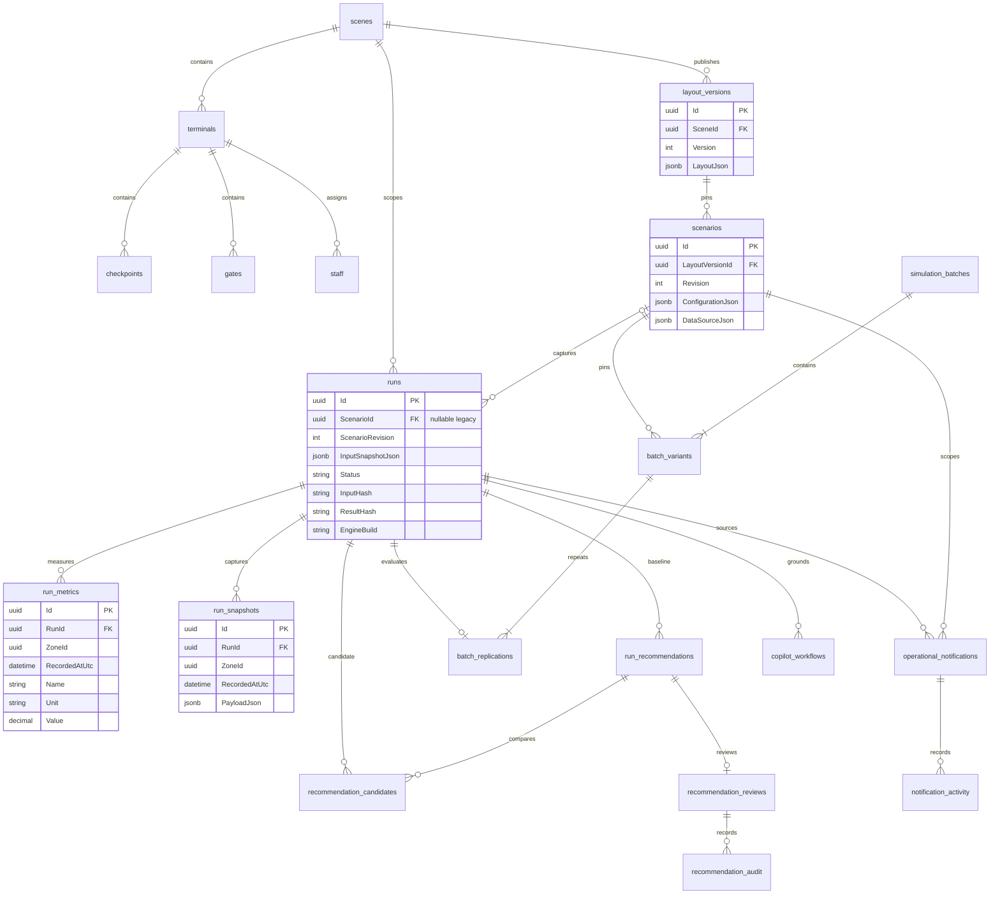

# Model de date, ERD și contracte API

[Înapoi la documentația produsului](../README.md). Owner: **Backend lead**; contractele de calcul au review obligatoriu și de la **Simulation lead**.

## ERD operațional

Diagrama reprezintă relațiile principale din PostgreSQL `twin`, nu toate coloanele și tabelele. Cheile fizice compuse includ `SceneId` unde este definit în configurațiile EF. Relațiile de proveniență păstrate numai în JSON sunt explicate separat; nu sunt desenate ca foreign keys inexistente.

Surse ale relațiilor: [EntityConfigurations](../../backend/src/AeroSynapse.Infrastructure/Storage/EntityConfigurations.cs), [RunResultConfigurations](../../backend/src/AeroSynapse.Infrastructure/Storage/RunResultConfigurations.cs), [BatchConfigurations](../../backend/src/AeroSynapse.Infrastructure/Storage/BatchConfigurations.cs), [reviews](../../backend/src/AeroSynapse.Infrastructure/Storage/RecommendationReviewConfigurations.cs), [notifications](../../backend/src/AeroSynapse.Infrastructure/Storage/NotificationConfigurations.cs).

| Date | Persistență / autoritate | Invariantă importantă |
| --- | --- | --- |
| Layout publicat | `twin.layout_versions.LayoutJson` | Versiunea capturată este referința scenariului |
| Zboruri, populații, fluxuri, personal alocat, incidente | `scenarios.ConfigurationJson` | Document validat; nu sunt tabele independente de zboruri/populații/incidente |
| Input run | `runs.InputSnapshotJson` și revizia scenariului | Nu se rescrie când scenariul se editează |
| Metrici / snapshot rezultat | `run_metrics`, `run_snapshots` | Interogare după run, zonă și timp simulat; numai rezultate valide implicit |
| Comenzi, progres, replay bookmarks | Comenzi/progres în tabele; bookmark-urile sunt evenimente persistate de replay | Idempotență și revizii; nu se recalculază KPI la redare |
| Recomandări | Baseline FK + fiecare candidat FK, review și audit | O recomandare nu echivalează cu aprobarea ei |
| Captură externă istorică (modul retras) | `external_data_snapshots`; legături/mapping în `DataSourceJson` și input run | Referința în JSON nu este un FK SQL; retenția verifică și aceste referințe |
| Audit / AI | `audit_events`, `ai_policies`, `ai_agent_events`, transcripturi și workflows | Evidențe distincte de metricile simulatorului, cu retenție și protecții specifice |
| Execuții Python | `intelligence.simulation_executions`, `simulation_cancellations` | Receipt al motorului, separat de run-ul autoritativ .NET; fără FK cross-service |

JSONB nu înseamnă JSON arbitrar: DTO-urile, schema, regulile de domeniu și unele constrângeri/triggere DB lucrează împreună. `ZoneId` dintr-un rezultat este verificat față de layout-ul capturat; nu se pretinde un FK universal către toate tipurile de zonă.

## Contexte separate și retenție

[AirportMapDbContext](../../backend/src/AeroSynapse.Infrastructure/Airports/AirportMapDbContext.cs) păstrează modelul inițial `Airport → Terminal → Floor → Zone`, rute, checkpoint-uri, porți și resource pools în SQLite; folosește `EnsureCreated`, fără un flux complet de migrare pentru baze existente. Nu există FK din acest store către `twin`.

[IdentityStore](../../backend/src/AeroSynapse.Infrastructure/Identity/IdentityStore.cs) este un alt context SQLite: tabelele standard ASP.NET Identity, `WorkspaceUser.TenantId` și `WorkspaceSession.UserId → user`. Membership-ul selectează stocarea tenantului prin configurația serverului. Identity și cheile Data Protection trebuie păstrate la restore, împreună cu bazele operaționale.

Scenariile au politici explicite `archive`, `restrict`, `purge`, cu verificarea relațiilor, reviziei și execuțiilor active; nu se presupune cascade delete pentru tot graful. Auditul și sursele referite pot supraviețui ștergerii scenariului. Auditul/capturile externe folosesc retenția configurată (implicit 90 zile), iar transcripturile au politica lor separată. DB owner/migration operator este o autoritate privilegiată; append-only prin API nu înseamnă imposibilitate de intervenție a administratorului DB.

Implementări: [run storage](../../backend/src/AeroSynapse.Infrastructure/Storage/RunStorageService.cs), [audit și acces](../security.md), [transcripturi](../explainable-copilot.md).

## Suprafața API

Prin nginx majoritatea rutelor .NET au prefix `/api`; direct pe API nu îl au. **Excepție:** harta inițială este definită deja sub `/api/airports`, iar proxy-ul păstrează prefixul. Browserul folosește `/api/hubs/operations`; API-ul definește hub-ul la `/hubs/operations`. `/intelligence/*` din browser este o fațadă .NET restricționată, nu acces direct la toate rutele Python.

| Operație | Rută prin frontend | Contract / comportament |
| --- | --- | --- |
| CSRF, sesiune | `GET /api/auth/csrf`, `POST /api/auth/login`, `GET /api/auth/session` | Cookie protejat și `X-CSRF-TOKEN`; parole numai în cererea de login, niciodată în exemple versionate |
| Scenarii | `GET/POST /api/scenarios`, `PUT /api/scenarios/{id}`, `POST .../{id}/duplicate` | DTO .NET și revizie optimistă, erori explicite |
| Comandă simulare | `POST /api/scenarios/{id}/simulations` | `{scenarioRevision}`, header `Idempotency-Key` UUID nenul, 202 + comandă/run |
| Status / rezultate | `GET /api/simulations/{commandId}`, `/api/runs/{runId}`, `.../metrics`, `.../snapshots` | RunId, status, validitate, motiv de eșec și filtre de timp/zonă |
| Replay / compare | `GET /api/runs/{runId}/replay`, `.../compare/{candidateId}` | Captură hash-uită și comparație de intrări, versiuni și rezultate |
| Batch | `POST /api/simulation-batches`, `GET .../{id}`, `POST .../{id}/cancel` | `commandId` în JSON; nu se confundă cu header-ul comenzii individuale |
| OpenAPI management | `GET /api/openapi/v1.json` | Rute/DTO generate de API-ul configurat; acces potrivit politicilor deployment-ului |
| Contracte motor | `/api/contracts/v1/*` în .NET; `/contracts/v1/*` intern în Python | Exemple, validări și aceleași coduri de eroare |
| Motor intern | `POST /simulation/runs`, `GET /simulation/runs/{runId}` în FastAPI | Receipts persistate, corelare și recuperare; nu API public al browserului |

Lista este o hartă de integrare, nu o specificație completă de endpoint-uri. Vezi [endpoint-urile API](../../backend/src/AeroSynapse.API/), [fluxul operatorului](../simulation-journey.md), [algoritmi și batch](algorithms-and-assumptions.md), [Identity](../security.md).

Salvarea rezultatului terminal Python are patru încercări cu backoff limitat; calculul nu se repetă.
Un rezultat terminal deja confirmat, inclusiv anularea sau expirarea, nu este suprascris la retry.
După epuizarea încercărilor, serviciul răspunde 503. Receipt-urile fără deadline care nu au publicat
un rezultat în decurs de o oră sunt închise la următorul GET sau POST repetat, cu
`simulation_result_unavailable`; cele controlate respectă deadline-ul original.

Copilot compară intrările curente după aceeași normalizare a timpilor boarding folosită la captură;
revizia, layout-ul și celelalte intrări rămân obligatoriu identice. Anularea internă a unei evaluări
deținute de un workflow nu depinde de autorizarea unor apeluri Copilot noi: proprietatea este
verificată în DB, iar cleanup-ul este înregistrat ca `workflow_cleanup` în auditul AI.

Cererea anonimă către o resursă protejată produce 401, lipsa rolului 403; revizia/identitatea comenzii conflictuale 409. Validarea de contract produce 422 și coduri de câmp; JSON/request binding invalid poate produce 400, media invalidă 415, rate limiting 429, motor indisponibil 502. Nu se reduce tot API-ul la un singur envelope de eroare: contractele motorului folosesc envelope-ul versionat, iar managementul folosește și ProblemDetails/erori de domeniu. Logurile și erorile nu trebuie să conțină secrete sau payload-uri externe nefiltrate. `X-Correlation-ID` leagă cererea și logurile ambelor servicii.

## Contracte versionate și unități

[contracts/v1/contract.schema.json](../../contracts/v1/contract.schema.json) și [contract.openapi.json](../../contracts/v1/contract.openapi.json) sunt contractele de bază publicate, cu `contractVersion: "1.0"`; exemplele și corpusurile sunt alături. Familiile suplimentare au propriile directoare `contracts/<familie>/v1/`, modele și teste. Nu orice JSON de management este un `SimulationRequest` v1; nici `RunInputSnapshot` intern nu este DTO-ul public `ScenarioSnapshot`.

| Mărime | Convenție comună |
| --- | --- |
| Timp motor / așteptare | Minute simulate; 1 minut = 60 secunde; nu timp de execuție |
| Rate | Pasageri/minut; `serviceRatePerMinute` este per operator; capacitatea depinde de personal |
| UTC / fus | Instanți UTC cu `Z`; `timeZone` IANA pentru afișare, nu pentru schimbarea orizontului |
| Spațiu | Metri în coordonate locale; Blender Z-up → glTF/Three.js Y-up conform manifestului |
| Proporții | Fracție 0–1 în KPI unde schema o definește; UI poate afișa ×100%; nu se confundă cu inputul surge |
| Seed | Întreg explicit, comun C#/Python, 0–2147483647; versiunea/build-ul și intrările sunt necesare reproducerii |

JSON-ul este UTF-8, cu reguli pentru câmpuri obligatorii, necunoscute/duplicate, UUID, numere finite și limite pe fiecare familie. Motorul legacy de bază și SimPy au limite diferite (de exemplu suportul pentru populație zero); se consultă schema exactă, fără extrapolarea limitelor unui DTO către altul.

Schimbarea incompatibilă a unui câmp, unități, limite sau semnificații cere versiune nouă, corpus nou și tranziție explicită; nu se rescrie baseline-ul/hash-ul doar pentru a face testul verde. Execută `node scripts/test-critical.mjs` pentru gate-ul comun și `sh scripts/test-contracts.sh` sau `./scripts/test-contracts.ps1` pentru suita dedicată. Output-ul Python este corelat cu cererea capturată înainte de salvare; un JSON valid sintactic poate fi totuși un rezultat invalid.
